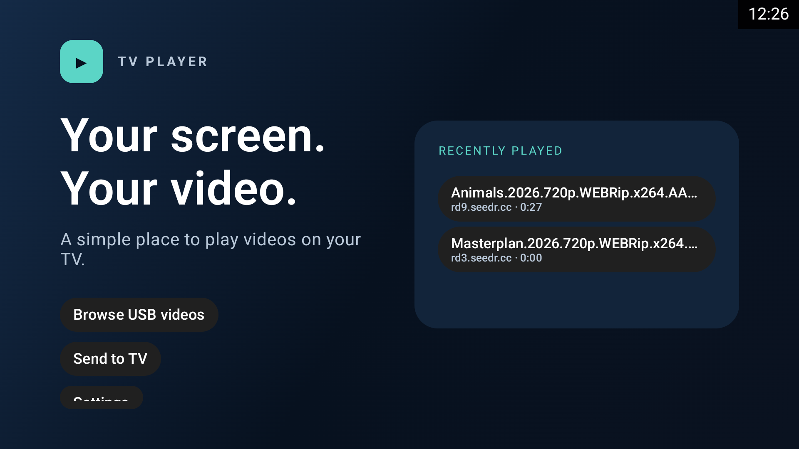
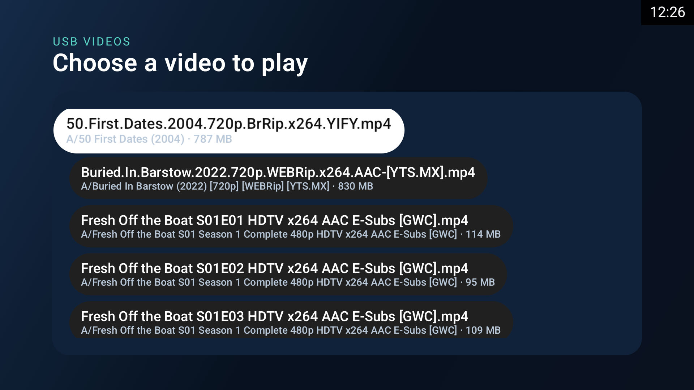

# TV Player

A remote-first Android TV video player for direct links and USB drives, with subtitles, playback history, and an easy phone-to-TV handoff.

TV Player plays direct HTTP(S) video links and videos indexed on mounted USB drives. Its phone-friendly handoff page lets you send a link or upload a video and optional subtitle from another device on the same Wi-Fi. Playback, settings, and the handoff interface are designed for the TV remote. The app does not depend on Seedr or a cloud service.

## Preview

| Home | Browse videos on USB |
|:--:|:--:|
|  |  |

The player UI, settings, and errors are in English. Subtitle tracks may contain any language and Unicode text supported by the media stack.

## Project status

The roadmap, completed milestones, and verification notes are tracked in the [implementation plan](docs/PLAN.md), [progress log](docs/PROGRESS.md), and [local build and TV QA guide](docs/SETUP_AND_QA.md).

## Development workflow

- The core milestones were implemented one at a time on numbered branches, each stacked from the previous milestone commit.
- Keep each branch focused; commit every completed feature before starting the next milestone.
- Keep implementation and verification status distinct. Record exactly which checks ran and which remain pending; a source review does not prove that a build or device behavior works.
- Do not push branches, create a GitHub repository, or merge to `main` without an explicit request.
- Local build/lint, TV installation, and app launch are authorized. D-pad interaction, playback, visual, and functional QA still require manual checks and are not claimed complete.

## Tentative product identity

The working name is **TV Player**. The Android application ID is `dev.lmadhuranga.tvplayer`, distinct from Seedr's identity.
